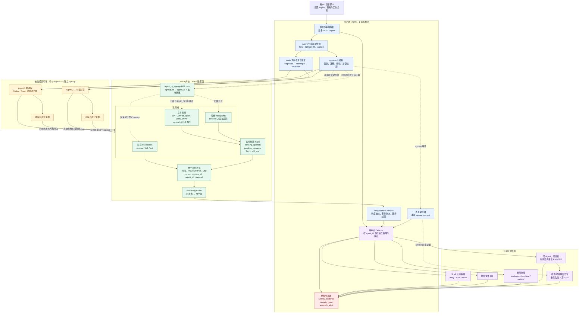

# 项目整体架构图

更新时间：2026-09-29

这张图描述当前已经实现的正式原型。实线表示主要运行数据流，虚线表示配置、
控制或关联关系。图中不包含尚未实现的 HTTPS 明文、Prompt/Response 精确关联和
多 Agent 协作/竞争检测。

## 阅读顺序

1. 用户通过 `monitor` 或演示脚本配置一个或多个 Agent。
2. 用户态控制面创建独立 cgroup，执行两阶段门控和降权，并在 BPF map 中登记
   `cgroup_id → agent_id`。
3. Agent 及其后代在内核中触发进程、文件和网络观测点；未登记 cgroup 的事件被过滤。
4. eBPF 生成统一事件，经 Ring Buffer 送到用户态 Collector。
5. Detector 把事件与每个 Agent 的策略、重复活动状态和 cgroup CPU 样本关联。
6. 系统输出活动证据、安全告警或资源/逻辑联合异常。
7. 根进程退出后仍继续监控后代；只有 `cgroup.events` 显示 `populated=0`，才注销
   BPF map 并输出最终 `agent_exit`。

## 源码对应关系

| 图中模块 | 主要源码 |
| --- | --- |
| 统一事件协议 | `include/events.h` |
| eBPF 观测点、maps、Ring Buffer | `src/monitor.bpf.c` |
| 参数、受控启动、cgroup、Collector | `src/monitor.c` |
| 用户态异常规则 | `include/detector.h`、`src/detector.c` |
| CPU 资源采样 | `include/resource_sampler.h`、`src/resource_sampler.c` |
| 工作负载、演示与性能评测 | `experiments/` |
