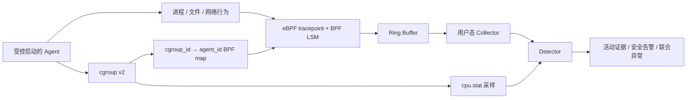

# 系统设计与实现说明

更新时间：2026-09-28

## 1. 目标与边界

本项目实现一个基于 eBPF 的系统级多 Agent 异常监测原型。它不修改内核源码，
也不要求修改被监控 Agent；监控器通过受控启动把每个 Agent 放入独立 cgroup v2，
从内核侧采集进程、文件和网络事件，再在用户态完成归属、关联、策略判断和告警。

当前目标是覆盖赛题基础要求并提供可复现证据。HTTPS 明文、Prompt/Response 捕获、
特定 Prompt 到系统调用的精确因果链，以及多 Agent 协作/竞争异常仍属于进阶方向，
不作为现有能力声明。

## 2. 总体架构



内核态只执行过滤、必要的参数配对、真实路径解析和事件提交。策略、时间窗口、
CPU 联合判断和日志输出位于用户态，避免把复杂状态机放入 eBPF，同时便于后续增加
应用层交互事件而不重写采集协议。

## 3. Agent 归属与生命周期

监控器为每个 `--agent ID` 创建独立 cgroup，并在放行目标进程前把
`cgroup_id → agent_id` 写入 BPF map。子进程和线程自然继承 cgroup，因此无需依赖
容易受重父化和 PID 复用影响的父子链来决定归属。PID/PPID 仍保留用于回溯。

启动使用两阶段门控：孩子先在原 cgroup 中完成 `initgroups`，父进程再迁移孩子、
登记映射并放行；孩子随后执行 `setresgid/setresuid`，以 sudo 调用者身份执行
Agent。这避免把 root 身份的 NSS 准备访问误归入 Agent。

根进程退出不代表整个 Agent 结束。监控器先输出 `agent_root_exit`，继续保留映射
并读取 `cgroup.events` 的 `populated` 状态。只有所有后代自然退出、cgroup 变空后，
才输出 `agent_cgroup_drained` 和 `agent_exit ... basis=cgroup_empty`，然后注销映射。
当前不会自动终止长期存活的后代，因此后台计算可以继续，但监控器也会持续运行。

## 4. 采集协议与观测点

所有 Ring Buffer 事件以 `monitor_event_header` 开始，包含单调时间戳、事件大小、
类型、PID/TID/PPID、UID、comm、原始 cgroup_id 和映射后的 agent_id。用户态先校验
事件长度，再按事件类型分派。

| 事件 | 观测方式 | 主要语义 |
| --- | --- | --- |
| `EXEC_ATTEMPT` | `sys_enter_execve` tracepoint | 执行尝试，不证明 exec 成功 |
| `PROCESS_FORK` | `sched_process_fork` | 已成功创建子任务 |
| `PROCESS_EXIT` | `sched_process_exit` | 当前任务退出及原始 exit_code |
| `FILE_OPEN` | BPF LSM `file_open` | 已存在对象的内核真实路径与 flags |
| `FILE_UNLINK_ATTEMPT` | BPF LSM `path_unlink` | 删除前尝试；父目录真实路径加 dentry 名称 |
| `FILE_OPEN_RESULT` | `sys_enter/exit_openat` | 当前仅提交失败结果及还原尝试路径 |
| `CONNECT_RESULT` | `sys_enter/exit_connect` | IPv4/IPv6 目标、端口和 syscall 返回值 |

`FILE_OPEN` 和删除父目录使用 `bpf_d_path`，属于内核解析后的路径。失败 openat 的
对象不存在，无法由 LSM 提供真实路径，因此明确标为 `reconstructed_attempt`，
不宣称是规范路径。`CONNECT_RESULT ret=-115` 表示非阻塞 EINPROGRESS，不能直接
解释为连接最终成功。

## 5. 用户态检测

`detector.c` 按 agent_id 保存独立策略，原始事件仍可展示，检测输出分为
`activity_evidence`、`security_alert` 和 `anomaly_alert`。

### 5.1 Shell 策略

`--shell-policy deny|audit|allow` 按可执行文件 basename 精确匹配常见 Shell。

- `deny`：输出 high `unexpected_shell`。
- `audit`：输出 `shell_execution` 活动证据，不直接判异常。
- `allow`：检测器不输出。
- 未配置：规则关闭；旧 `--deny-shell` 等价于 `deny`。

三态设计来自真实 Codex 验证：框架本身会正常启动 Bash，不能把所有 Shell 尝试
都解释为攻击。

### 5.2 敏感读取

`--sensitive-path DIR` 配置敏感目录。对范围内具有读取能力、且不是目录打开的
`FILE_OPEN` 输出 high `sensitive_file_access`。路径采用规范化目录边界匹配，
避免把相似字符串前缀误认为子目录。

### 5.3 删除分级

`--workspace DIR` 是允许的业务工作区；可重复的 `--runtime-path DIR` 是 Agent
框架自身需要维护的运行目录。

- workspace 内：静默。
- runtime-path 内：输出 `runtime_file_delete` 审计证据。
- 其他路径：输出 high `outside_workspace_delete`。

策略按目标真实路径判断，不按 Codex、Bubblewrap 等进程名硬编码忽略。部署者仍需
显式定义授权边界，系统不会自动理解业务权限。

### 5.4 资源与逻辑联合异常

失败 `openat` 按同一 Agent、同一目标和时间窗口计数；达到阈值时输出 medium
`repeated_failed_open`。用户态同时从 Agent cgroup 的 `cpu.stat` 计算相邻区间
CPU 使用率。只有重复失败证据和高 CPU 在同一 Agent、同一窗口内同时成立，才输出
high `resource_logic_anomaly`。该规则证明一种“重复无意义文件活动 + 资源消耗”
组合，不等同于通用逻辑死循环检测。

## 6. 验证结果

确定性一键验收命令为：

```bash
./experiments/run_acceptance_demo.sh
```

用户实测两个 Agent 的注册/退出、fork、本地 IPv4 connect、三类安全规则、重复
失败活动和资源联合异常共 11 项全部 PASS，最终 `DEMO_RESULT=PASS`。

真实 Codex 验证包括：双 Agent 并发归属与独立文件读取、真实网络连接、敏感文件
读取、Shell deny/audit、工作区外删除及运行时删除审计。根进程先退出实验还确认：
后代被重父化给 PID 1 后仍保留正确 agent_id/cgroup_id，并在自然退出前持续受监控。
详细命令和证据见 `experiments/` 下的专项文档以及
[验收证据清单](acceptance-status.md)。

## 7. 性能与限制

VirtualBox 开发环境中，文件事件每 100 次抽样一次的 15 对稳定性测试，总开销
逐对中位数为 8.08%，p25/p75 为 6.02%/15.29%，尚未达到赛题 5% 参考指标。
默认全量文件模式开销更高；抽样又可能漏掉普通打开，并与敏感目录规则互斥。
这些结果只能作为开发阶段初测，不能代替真实 Linux 机器测量。

当前其他限制：

- 尚未覆盖 `openat2`、`unlinkat`、`rename`。
- 尚无更多实例压力、事件丢失率和长时间稳定性数据。
- 尚未在 Linux 5.15 实机复测；当前开发内核满足最低版本但版本更高。
- BPF LSM 必须在启动参数中启用。
- 删除事件来自操作前 LSM 钩子；是否最终成功需要工作负载结果或后续证据佐证。
- 运行时路径、敏感范围和工作区依赖部署者配置。

## 8. 工程结构与扩展点

- `include/events.h`：稳定的内核态/用户态事件协议。
- `src/monitor.bpf.c`：内核采集与 cgroup 过滤。
- `src/monitor.c`：控制面、生命周期、Ring Buffer collector。
- `src/detector.c`：用户态策略和关联检测。
- `src/resource_sampler.c`：cgroup CPU 采样。
- `experiments/`：确定性工作负载、真实 Agent 验证和性能测量。

后续加入 Prompt/Response 或 TLS uprobe 时，可以定义新的应用层事件并复用
agent_id、timestamp_ns 和 cgroup_id 作为关联键；检测器再把应用层交互与现有内核
事件放入统一时间窗口。这个边界允许扩展跨层因果分析，同时不改变现有采集路径。
